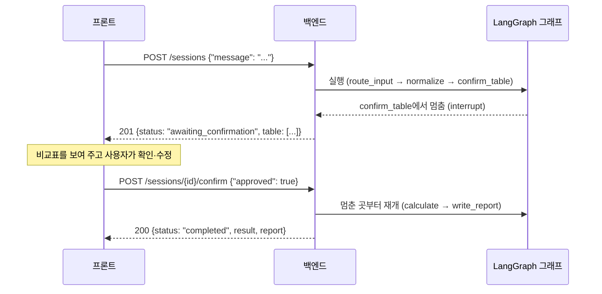

# 백엔드 세션 API 사용법

> 대상: 백엔드를 처음 띄워 보는 사람, 프론트에서 백엔드를 부르는 사람
> 기준: backend `main` (korcham-maeil-2/backend#26, 2026-11-13)
> 코드 위치: `backend/src/backend/` — 각 파일 맨 위에 개념 설명 주석이 있다

## 1. 한 줄 요약

사용자가 공고 내용을 보내면 백엔드가 **비교표를 만들고 멈춰서 확인을 기다린다**. 사용자가 확인하면 **이어서 계산하고 결과를 돌려준다**.

```
POST /sessions            → 비교표 만들고 멈춤   (status: awaiting_confirmation)
POST /sessions/{id}/confirm → 이어서 끝까지 실행 (status: completed)
```

지금은 뼈대 단계라 비교표·계산·리포트 노드가 빈 값을 돌려준다. 주소와 응답 모양은 이대로 유지하고, 각 노드는 기능 이슈(#5 정규화, #7·#8 계산, #12 파일 입력, #19 리포트)에서 채운다.

## 2. 서버 띄우기

필요한 것: [uv](https://docs.astral.sh/uv/) (Python 3.13은 uv가 알아서 맞춘다)

```bash
cd backend
uv sync                                  # 처음 한 번: 패키지 설치
uv run fastapi dev src/backend/main.py   # 서버 실행 (코드를 고치면 자동 재시작)
```

- 서버 주소: http://localhost:8000
- **API 시험 화면: http://localhost:8000/docs** — 엔드포인트를 눌러 "Try it out"으로 직접 보내 볼 수 있다
- 살아 있는지 확인: http://localhost:8000/health → `{"status":"ok"}`
- 테스트: `uv run pytest`

세션 상태는 `backend/var/checkpoints.sqlite` 파일에 저장된다 (git 제외). 서버를 껐다 켜도 이어서 진행된다. 처음부터 다시 하고 싶으면 서버를 끄고 `var/` 폴더를 지우면 된다.

## 3. 전체 흐름



프론트는 응답의 **`status`만 보고 화면을 고르면 된다.**

| status | 뜻 | 프론트가 할 일 |
|---|---|---|
| `awaiting_confirmation` | 비교표 확인을 기다리며 멈춤 | `table`을 보여 주고 확인 버튼 → `/confirm` |
| `completed` | 끝까지 실행됨 | `result`, `report`를 보여 줌 |
| `running` | 그 밖 (지금 구조에선 거의 안 나옴) | `GET /sessions/{id}`로 다시 조회 |

## 4. 엔드포인트

| 메서드 | 주소 | 하는 일 | 성공 | 실패 |
|---|---|---|---|---|
| POST | `/sessions` | 세션 시작. 비교표를 만들고 멈춘다 | 201 | 422 |
| POST | `/sessions/{session_id}/messages` | 메시지 추가. 이전 메시지와 합쳐 비교표를 다시 만들고 멈춘다 | 200 | 404, 422 |
| POST | `/sessions/{session_id}/confirm` | 비교표 확인. 멈춘 곳부터 끝까지 실행 | 200 | 404, 409, 422 |
| GET | `/sessions/{session_id}` | 현재 상태 조회 (실행하지 않음) | 200 | 404 |

모든 성공 응답은 아래 **세션 응답** 모양 하나다.

### 세션 시작

```bash
curl -X POST localhost:8000/sessions \
  -H 'content-type: application/json' \
  -d '{"message": "판교 백엔드 신입 연봉 3,600만원"}'
```

```json
{
  "session_id": "670133b0-5987-424d-bc91-99b90a088bad",
  "status": "awaiting_confirmation",
  "pending": {
    "type": "confirm_table",
    "payload": { "type": "confirm_table", "table": [{ "raw_text": "판교 백엔드 신입 연봉 3,600만원" }] }
  },
  "table": [{ "raw_text": "판교 백엔드 신입 연봉 3,600만원" }],
  "table_confirmed": false,
  "result": null,
  "report": null
}
```

- `session_id`는 다음 요청에 계속 쓴다. 로그인이 없으므로 프론트가 들고 있어야 한다.
- `table`(비교표) 한 행의 칸은 #5에서 정한다. 지금은 `raw_text`만 있다.

### 비교표 확인

```bash
curl -X POST localhost:8000/sessions/{session_id}/confirm \
  -H 'content-type: application/json' \
  -d '{"approved": true}'
```

사용자가 표를 고쳤으면 고친 표를 함께 보낸다. 보낸 표가 그대로 다음 계산에 쓰인다.

```json
{ "approved": true, "table": [{ "raw_text": "...", "company": "(가상) 빛가람그리드(주)" }] }
```

응답:

```json
{
  "session_id": "670133b0-...",
  "status": "completed",
  "pending": null,
  "table": [{ "raw_text": "판교 백엔드 신입 연봉 3,600만원" }],
  "table_confirmed": true,
  "result": { "rows": 1, "monthly_remaining": null },
  "report": "계산 엔진이 아직 연결되지 않았습니다."
}
```

### 메시지 추가 / 조회

```bash
curl -X POST localhost:8000/sessions/{session_id}/messages \
  -H 'content-type: application/json' -d '{"message": "교통비 월 10만원"}'
curl localhost:8000/sessions/{session_id}
```

## 5. 응답 형식 약속

**성공은 데이터를 감싸지 않고 그대로, 실패는 HTTP 4xx·5xx + 항상 아래 한 가지 모양.**

```json
{ "code": "SESSION_NOT_FOUND", "message": "세션을 찾을 수 없습니다.", "details": null }
```

- `code`: 프론트가 분기에 쓰는 고정 영문 코드
- `message`: 사용자에게 그대로 보여 줘도 되는 한국어 문장
- `details`: 422일 때만 어느 칸이 왜 틀렸는지 목록, 나머지는 `null`

| code | HTTP | 언제 |
|---|---|---|
| `SESSION_NOT_FOUND` | 404 | 없는 `session_id` |
| `SESSION_NOT_AWAITING_CONFIRMATION` | 409 | 확인을 기다리지 않는 세션에 `/confirm` (이미 끝남 등) |
| `VALIDATION_ERROR` | 422 | 요청 JSON이 틀림. 예: 빈 `message` |
| `NOT_FOUND` | 404 | 없는 주소 |
| `METHOD_NOT_ALLOWED` | 405 | 주소는 있는데 GET/POST가 틀림 |
| `HTTP_ERROR` | 그 밖 4xx | |
| `INTERNAL_ERROR` | 500 | 서버 버그. 내부 내용은 숨기고 서버 로그에만 남는다 |

422 예시:

```json
{
  "code": "VALIDATION_ERROR",
  "message": "요청 형식이 올바르지 않습니다.",
  "details": [{ "field": "body.message", "message": "String should have at least 1 character" }]
}
```

새 에러를 추가하는 방법은 `backend/src/backend/api/errors.py` 맨 위 주석에 있다.

## 6. 프론트에서 부르기

### 타입 자동 생성

백엔드 서버를 켠 상태에서 `openapi-typescript`로 `/openapi.json`을 TS 타입으로 만든다. 세션 응답(`SessionResponse`)과 에러 응답(`ErrorResponse`, `ErrorCode` 목록)이 모두 들어 있다.

```bash
cd frontend
pnpm dlx openapi-typescript http://localhost:8000/openapi.json -o src/lib/api/schema.d.ts
```

frontend에 `gen:api` 스크립트가 생기면 `pnpm gen:api`로 같은 일을 한다 (frontend#2).
2026-11-13에 이 명령으로 생성한 타입과 아래 예시 코드가 `tsc --strict`를 통과하는 것을 확인했다.

### 호출 예시 (TypeScript)

```ts
import type { components } from '@/lib/api/schema';

type Session = components['schemas']['SessionResponse'];
type ApiError = components['schemas']['ErrorResponse'];

const BASE = process.env.NEXT_PUBLIC_API_BASE ?? 'http://localhost:8000';

async function call<T>(path: string, init?: RequestInit): Promise<T> {
  const res = await fetch(`${BASE}${path}`, {
    ...init,
    headers: { 'content-type': 'application/json', ...init?.headers },
  });
  if (!res.ok) {
    const err = (await res.json()) as ApiError; // 실패는 항상 이 모양
    throw err; // 화면에서는 err.message를 보여 주고, err.code로 분기
  }
  return res.json() as Promise<T>;
}

export const startSession = (message: string) =>
  call<Session>('/sessions', { method: 'POST', body: JSON.stringify({ message }) });

export const confirmTable = (id: string, table?: Session['table']) =>
  call<Session>(`/sessions/${id}/confirm`, {
    method: 'POST',
    body: JSON.stringify({ approved: true, table }),
  });

export const getSession = (id: string) => call<Session>(`/sessions/${id}`);
```

## 7. 환경 변수 (`backend/.env`, 형식은 `backend/.env.example`)

| 이름 | 기본값 | 설명 |
|---|---|---|
| `CHECKPOINT_DB_PATH` | `var/checkpoints.sqlite` | 세션 상태 SQLite 파일. Docker에서는 볼륨 경로로 |
| `CORS_ORIGINS` | `http://localhost:3000` | 브라우저 호출을 허락할 프론트 주소. 여러 개면 쉼표로 |
| `DATA_GO_KR_SERVICE_KEY`, `WORK24_*` 등 | — | 공공데이터 API 키. 값은 저장소에 올리지 않는다 |

### 배포할 때 CORS

- **프론트와 백엔드를 같은 도메인으로 묶으면 CORS 설정이 필요 없다.** 리버스 프록시나 Next.js `rewrites`로 `https://도메인/api/…` → 백엔드로 보내고, 프론트는 `/api/sessions`처럼 상대 주소로 부른다.
- 주소가 다르면 `CORS_ORIGINS=https://프론트도메인`처럼 정확한 주소를 적는다 (`https://`부터, 끝에 `/` 없이).
- Next.js 서버 컴포넌트·서버 액션에서 부르는 요청은 브라우저를 거치지 않아 CORS와 상관없다.

## 8. 그래프 구조 (백엔드 작업자용)

```
START → route_input → normalize → confirm_table(멈춤) → calculate → write_report → END
```

| 파일 | 내용 |
|---|---|
| `graph/state.py` | 그래프 상태 칸 (`messages`, `table`, `result` …). `messages`는 덮어쓰지 않고 뒤에 쌓인다 |
| `graph/nodes.py` | 노드 함수. 바꿀 칸만 `return`. `confirm_table`의 `interrupt()`가 멈추는 곳 |
| `graph/builder.py` | 노드를 화살표로 잇고 체크포인터(SQLite)와 함께 compile |
| `api/sessions.py` | 세션 엔드포인트. `session_id` = LangGraph `thread_id` |
| `api/schemas.py` | 요청·응답 모양 (Pydantic) |
| `api/errors.py` | 실패 응답 형식과 에러 코드 |
| `main.py` | 앱 생성, SQLite 연결, CORS, 에러 처리기 등록 |

노드를 채울 때 지킬 것:

- 노드는 상태를 직접 고치지 않고, 바꿀 칸만 dict로 돌려준다.
- 숫자 계산은 LLM이 아니라 `calculate`의 파이썬 코드가 한다.
- 새 노드를 추가하면 `builder.py`에서 `add_node`·`add_edge`로 연결하고, `tests/test_sessions.py`에 흐름 테스트를 추가한다.
- LangGraph는 1.x 문법만 쓴다 (`langgraph.types.interrupt`, `Command(resume=...)`).
